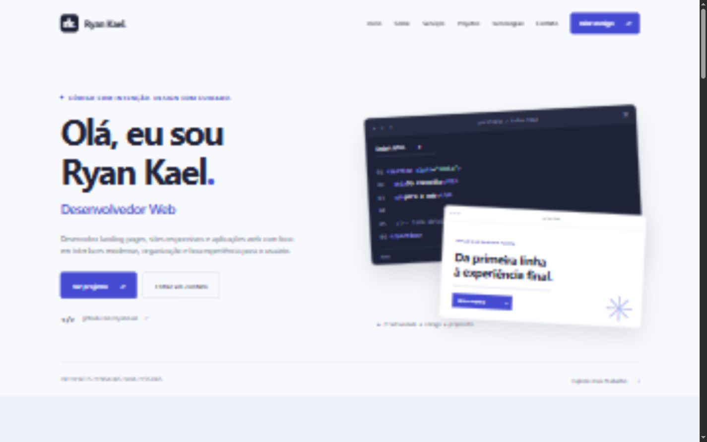
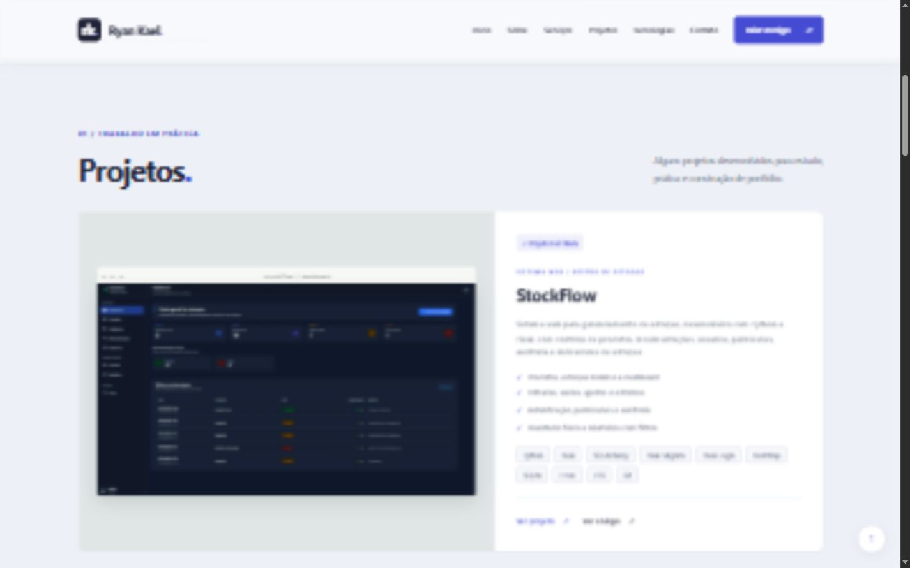

# Ryan Kael — Portfólio

## Sobre

Portfólio profissional de Ryan Kael, desenvolvedor web. Site estático em HTML5, CSS3 e JavaScript puro, sem frameworks, backend, bibliotecas externas ou etapa de build. Apresenta projetos práticos de estudo e serviços, sem atribuir experiências profissionais, clientes ou resultados fictícios ao autor.

**Demo prevista após publicação:** [ryankael.github.io/portfolio](https://ryankael.github.io/portfolio/). A publicação ainda não foi realizada.

## Preview



Identidade clara com detalhes em índigo, composição de código feita em HTML/CSS e destaques para StockFlow (aplicação Full Stack) e Aurora Residence (landing page).

## Projetos

| Projeto | Demo | Código |
| --- | --- | --- |
| StockFlow | [Abrir aplicação](https://stockflow-production-75ac.up.railway.app) | [GitHub](https://github.com/RyanKael/stockflow) |
| Aurora Residence | [Abrir demo](https://ryankael.github.io/aurora-residence-landing-page/) | [GitHub](https://github.com/RyanKael/aurora-residence-landing-page) |
| Forno da Vila | [Abrir demo](https://ryankael.github.io/forno-da-vila-landing-page/) | [GitHub](https://github.com/RyanKael/forno-da-vila-landing-page) |
| Your Clinic | [Abrir demo](https://ryankael.github.io/your-clinic-landing-page/) | [GitHub](https://github.com/RyanKael/your-clinic-landing-page) |
| Nexa Academy | [Abrir demo](https://ryankael.github.io/next-academy-landing-page/) | [GitHub](https://github.com/RyanKael/next-academy-landing-page) |

As demos das landing pages representam marcas e ofertas fictícias. StockFlow é um projeto prático de gestão de estoque; não é apresentado como um sistema comercial utilizado por clientes. Nexa Academy mantém o nome visual, embora o repositório use `next-academy`.

### Screenshots utilizados

Cópias locais derivadas de screenshots reais existentes nos projetos originais:

| Origem (relativa à pasta de projetos) | Arquivo no portfólio |
| --- | --- |
| `stockflow/docs/screenshots/dashboard.png` | `assets/images/projects/stockflow.webp` |
| `landingpage/assets/screenshots/desktop.png` | `assets/images/projects/forno-da-vila.webp` |
| `YourClinic/assets/images/preview-desktop.png` | `assets/images/projects/your-clinic.webp` |
| `mentoria/assets/images/preview-desktop.png` | `assets/images/projects/nexa-academy.webp` |
| `imobiliarialanding/assets/preview.jpg` | `assets/images/projects/aurora-residence.webp` |

As capturas longas foram recortadas no topo para mostrar a página inicial, com largura de até 1440 px, e convertidas para WebP. As quatro capturas das landing pages somam aproximadamente 311 KiB. O dashboard do StockFlow foi preservado por inteiro, redimensionado para 1600 × 900 px e convertido para WebP. Os arquivos originais permanecem intactos. A nitidez das capturas depende dos arquivos fornecidos; o preview de Your Clinic já apresentava suavização.

## Tecnologias

**Implementação do portfólio:** HTML5, CSS3 e JavaScript puro.

**Tecnologias apresentadas como contato prático:** HTML5, CSS3, JavaScript, Bootstrap, Python, Flask, SQL, SQLite, SQLAlchemy, Git, GitHub e VS Code. Sem porcentagens ou alegações de senioridade.

## Funcionalidades

- Menu mobile com estado `aria-expanded`, fechamento por link, clique externo e Escape.
- Navegação por âncoras, rolagem suave e header com sombra ao rolar.
- Botão voltar ao topo e ano automático.
- Animações discretas com suporte a `prefers-reduced-motion`.
- Contato configurável; canais vazios ou inválidos ficam ocultos.
- HTML semântico, link de pular conteúdo, foco visível e descrições de imagens.
- Links externos com `target="_blank"` e `rel="noopener noreferrer"`.
- Imagens de projetos com dimensões declaradas e carregamento lazy.
- Title, description, Open Graph, Twitter Card e favicon SVG.
- Fontes do sistema, sem requisições externas para bibliotecas ou tipografia.

## Responsividade

Verificação no navegador em 320, 375, 425, 768, 1024 e 1440 px, sem rolagem horizontal. Layouts adaptam a composição do hero, menu, cards, tecnologias e processo.

### Verificação realizada em 13/10/2026

- Seis larguras solicitadas verificadas por dimensões do documento.
- Inspeção visual de desktop e mobile.
- Menu abre/fecha, Escape fecha e devolve foco ao botão; seleção de projeto fecha o menu.
- Âncoras existentes e navegação entre seções verificadas.
- Retorno ao topo e canais vazios ocultos verificados.
- Quatro screenshots carregados corretamente.
- Nenhum erro ou aviso registrado no console durante os testes.
- `node --check js/script.js` aprovado.
- Quatro demos, quatro repositórios e perfil GitHub retornaram HTTP 200.
- Assets locais e links externos seguros verificados.

**Limite da verificação:** o navegador de testes bloqueia URLs `file://`; portanto, a abertura direta de `index.html` não foi validada visualmente. O site foi testado por HTTP local. A implementação usa scripts clássicos e caminhos relativos, sem fetch, módulos, backend ou dependências de servidor. Publicação e comportamento no domínio final dependem da ativação do GitHub Pages.

## Estrutura

```text
portfolio/
├── index.html
├── css/
│   └── style.css
├── js/
│   └── script.js
├── assets/
│   ├── images/
│   │   ├── projects/
│   │   │   ├── stockflow.webp
│   │   │   ├── aurora-residence.webp
│   │   │   ├── forno-da-vila.webp
│   │   │   ├── your-clinic.webp
│   │   │   └── nexa-academy.webp
│   │   ├── preview-stockflow.png
│   │   ├── preview-desktop.png
│   │   └── social-preview.png
│   └── icons/
│       └── favicon.svg
├── README.md
├── .gitignore
└── .nojekyll
```

## Como executar

Abra `index.html` no navegador. Não é necessário instalar dependências.

Para servir por HTTP local, execute na pasta do projeto:

```sh
python -m http.server 4173 --bind 127.0.0.1
```

Acesse [localhost:4173](http://localhost:4173). Encerre com Ctrl+C.

## GitHub Pages

1. Crie um repositório público chamado `portfolio` na conta `RyanKael`.
2. Envie os arquivos desta pasta para a raiz da branch `main`, mantendo `index.html` na raiz e incluindo `.nojekyll`.
3. Em **Settings → Pages → Build and deployment**, escolha **Deploy from a branch**.
4. Selecione **main** e **/(root)**, depois **Save**.
5. Aguarde o workflow de publicação em **Actions** e abra [a URL prevista](https://ryankael.github.io/portfolio/).

[Documentação oficial do GitHub Pages](https://docs.github.com/en/pages/getting-started-with-github-pages/configuring-a-publishing-source-for-your-github-pages-site).

Não há build ou configuração de servidor. Caminhos internos são relativos. As URLs absolutas de Open Graph apontam para o endereço de publicação previsto e devem ser atualizadas se o repositório ou domínio mudar.

## Contato

Edite o objeto `CONTACT` no início de `js/script.js`:

```js
const CONTACT = {
  email: "",
  whatsapp: "",
  linkedin: "",
  github: "https://github.com/RyanKael"
};
```

- `email`: endereço de email válido.
- `whatsapp`: código do país, DDD e número; preferencialmente somente dígitos.
- `linkedin`: URL HTTPS completa do seu perfil no LinkedIn.
- `github`: URL HTTPS do perfil.

Email, WhatsApp e LinkedIn começam vazios e ocultos. Nenhum número pessoal foi inserido. Enquanto esses dados não forem preenchidos, os CTAs levam à seção de contato, que mostra somente o GitHub. Não existe formulário de envio nem serviço de mensagens neste site.

## Melhorias futuras

- Configurar pelo menos um canal direto de contato antes de divulgar comercialmente.
- Adicionar estudos de caso com decisões técnicas, desafios e aprendizados reais.
- Substituir previews originais por capturas mais nítidas quando disponíveis.
- Adicionar domínio próprio e versão em inglês, se fizer sentido para o público.

## StockFlow — informações verificadas

Inspeção somente de leitura do projeto local: README, documentação de demonstração, dependências, configuração, extensões, rotas, modelos, templates e remote Git. Nenhum arquivo do StockFlow foi alterado e o sistema não foi executado durante esta atualização.

- Screenshot escolhido: `docs/screenshots/dashboard.png`, com indicadores e movimentações em uma única tela.
- Tecnologias confirmadas e exibidas: Python, Flask, SQLAlchemy, Flask-Migrate, Flask-Login, Bootstrap 5, SQLite (desenvolvimento), HTML, CSS e Git.
- O projeto também documenta PostgreSQL em produção, Railway, Gunicorn e testes com pytest; não foram executados testes do StockFlow nesta tarefa.
- Funcionalidades identificadas: produtos e categorias, estoque mínimo, dashboard, movimentações e estornos, inventário físico, autenticação, perfis de acesso, auditoria, buscas, filtros e relatórios em PDF.
- GitHub confirmado pelo remote: https://github.com/RyanKael/stockflow
- Aplicação documentada: https://stockflow-production-75ac.up.railway.app
- Os dois links ficam diretamente no artigo `id="stockflow"` de `index.html`, para edição simples. Nenhuma URL precisou ser inventada e nenhuma informação essencial do card ficou pendente.
- O dashboard completo depende de autenticação na aplicação; não foram adicionadas credenciais ao portfólio.
- O portfólio continua estático e pronto para GitHub Pages; o Flask permanece hospedado separadamente.

### Verificação da inclusão do StockFlow

- Desktop (1440 px) e mobile (375 px) sem rolagem horizontal.
- Screenshot WebP carregado, cinco projetos presentes e console sem erros ou avisos.
- Os quatro artigos existentes foram comparados antes/depois e preservados integralmente.
- Links do StockFlow retornaram HTTP 200; a aplicação redirecionou para a tela de login.
- Âncoras, segurança dos links externos e existência dos assets relativos verificadas.
- CSS e JavaScript preservados; compatibilidade estática com GitHub Pages mantida. Deploy do portfólio não realizado.


